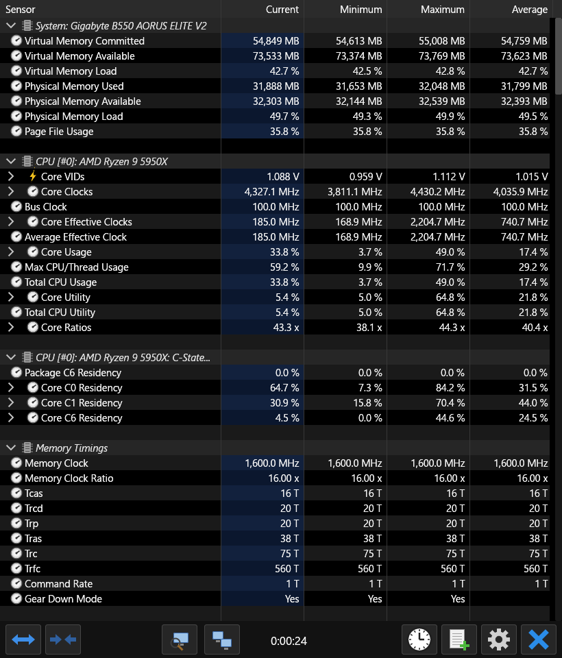
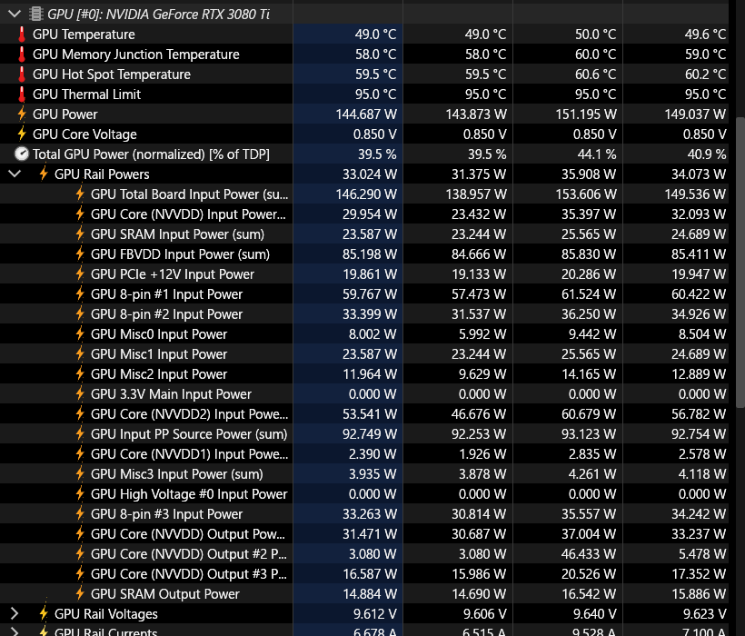
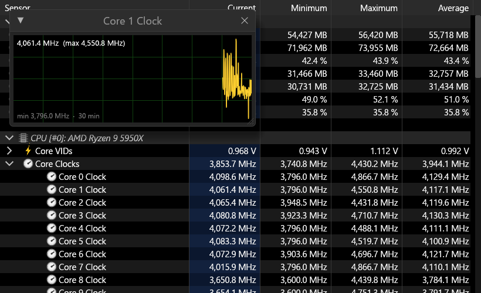
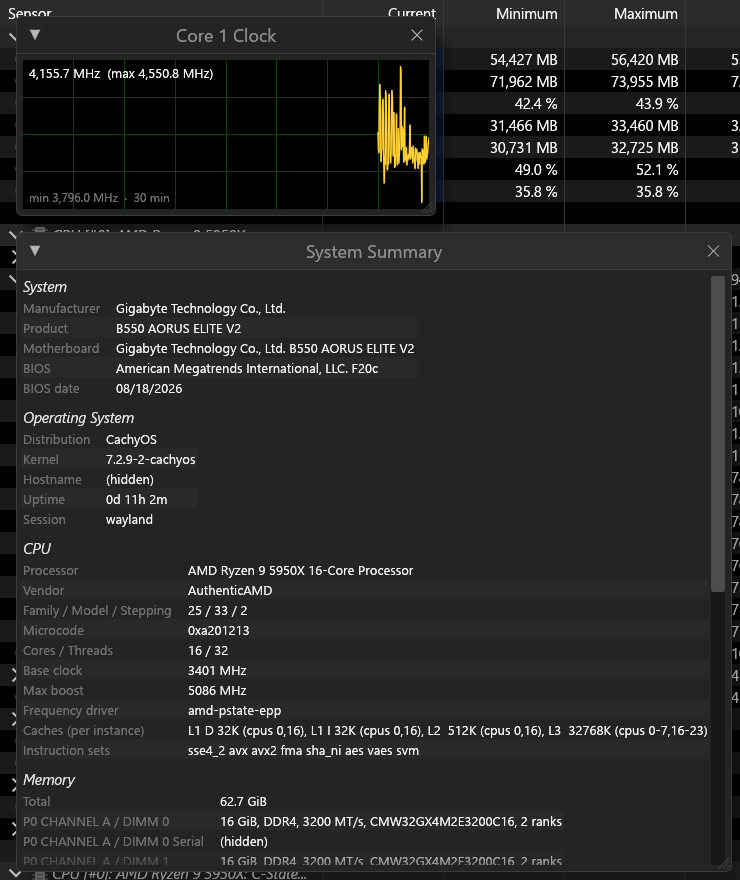

# hwinfo-rs

A HWiNFO64-style hardware sensor monitor for Linux, written in Rust. It has HWiNFO's
dark *Sensors Status* window, a live terminal mode, CSV logging and a Waybar module, and
it reads the same low-level sensors HWiNFO reads on Windows. Several of those were found
by reverse-engineering HWiNFO64 itself; see [`analysis/RE-REPORT.md`](analysis/RE-REPORT.md).



| GPU rails (NVAPI on Linux) | Graphs and right-click menu | System summary |
|---|---|---|
|  |  |  |

## Features

- **Sensors Status window**: Current / Minimum / Maximum / Average, collapsible groups,
  expandable per-core and per-thread rows, red flags for throttling and limits.
- **Right-click a row**: live graph (30 min history), rename, hide, min/max alert (desktop
  notification). Right-click a group to rename, reorder or hide it. The layout is saved to
  `~/.config/hwinfo-rs/config.json`.
- **System summary**: board/BIOS, OS, CPU (caches, microcode, ISA), memory modules,
  GPUs (VBIOS), drives and NICs. "Hide serial numbers" applies to screenshots too.
- **CLI**: `hwinfo-rs --cli` (live table), `--once`, `--filter`, `--log file.csv`.
- **Waybar**: `hwinfo-rs --waybar '{CPU (Tctl/Tdie)} {GPU Hot Spot Temperature}'`.
  It prints JSON lines with a tooltip, and the class turns `critical` while an alert is active.
- **Light**: CPU-rasterized UI (no GL/EGL in the process, so it never blocks the
  compositor), about 65 MB RSS and about 1–2 % of one core while sampling every 2 s.

## What it reads

| Hardware | Source | Notes |
|---|---|---|
| Every hwmon chip | libsensors (`/etc/sensors.d` labels apply) | Nuvoton, ITE, ASUS EC, ThinkPad, Dell, amdgpu, coretemp, k10temp, … |
| AMD Zen 1–3 desktop/APU | `ryzen_smu` pm_table, 10 layouts | per-core VID/clock/temp/power, C-states, SVI2 V/A/W, PPT/TDC/EDC, FCLK/UCLK, L3, DRAM bandwidth, power reporting deviation |
| AMD Zen 2/3 | `zen_extras` module (SMN, read-only) | IOD hotspot/average, HTC/PROCHOT, memory timings |
| Intel, AMD Zen 2+ | root helper: MSRs + powercap | per-thread effective clock/utility, RAPL package/core/GT/DRAM power, VIDs, C2–C10, throttling/limit flags, distance to TjMax, ring clock |
| NVIDIA | NVML + private NVAPI (`libnvidia-api.so.1`) | hot spot, core voltage, every power rail (W/V/A), % of TDP, perf limiters, effective/crossbar clock, PCIe errors per lane, per-process VRAM/load |
| NVIDIA Ampere/Ada | `nvvram` module | GDDR6/6X memory junction temperature |
| AMD / Intel GPUs | amdgpu / i915 / xe sysfs + hwmon | clocks, load, VRAM, temps, power |
| WDDM-style GPU rows | NVML + root helper | "D3D Usages" = per-engine busy (3D, encode, decode, JPEG, OFA); "D3D Memory Dedicated" = VRAM of GPU clients; "D3D Memory Dynamic" = system RAM clients mapped through /dev/nvidia*; "VR Usage" = GPU load of a running VR compositor (SteamVR, Monado, WiVRn, ALVR) |
| Drives | hwmon + root helper (smartctl) | temps, remaining life, spare, host/NAND writes, CRC errors |
| Laptops | power_supply | charge, wear level, rate, cycles |
| DDR4/DDR5 DIMMs | jc42 / spd5118 | needs an SMBus driver for your board |
| Gigabyte B550 boards | `gsa1_smbus` module | DIMM sensors + Renesas RAA229004 VRM through the board's own ACPI SMBus methods, so `acpi_enforce_resources=lax` is not needed |

Tested on a Ryzen 9 5950X / B550 / RTX 3080 Ti desktop and an i7-8650U ThinkPad T480.
The amdgpu, xe, Zen 2 and DDR5 paths are written from documentation but have not been
run on that hardware yet.

## Install (Arch / CachyOS)

```sh
git clone https://github.com/24bit192kHz/hwinfo-rs && cd hwinfo-rs
makepkg -si                                  # hwinfo-rs + hwinfo-rs-dkms
sudo systemctl enable --now hwinfo-rs-helper # root-only sensors (optional)
```

Other distros: `cargo build --release`, then copy the files in `dist/` and install the
modules in `kmod/` with DKMS. Optional runtime pieces: `smartmontools`, `dmidecode`,
`libnotify`, `ryzen_smu` (AMD), the NVIDIA driver (NVML/NVAPI).

On hybrid laptops, `HWINFO_RS_NO_NVIDIA=1` keeps it from waking a sleeping dGPU.

ITE IT8686E/IT8688E boards whose BIOS hides AVCC3: see
[`extra/it87-avcc3-dkms`](extra/it87-avcc3-dkms), a patched `it87` with `force_avcc3`.

## Safety

Everything is a read except these two writes:

- **DDR4 DIMM thermal sensors (jc42)**: the limit/config registers 0x01–0x04, and only
  when the firmware left the limits at 0 °C.
- **RAA229004 VRM (`gsa1_smbus`)**: PMBus `PAGE` = 0/1 to read both rails, always
  restored to 0. This is the same sequence HWiNFO uses, and the firmware's own VRM code
  sets the page explicitly.

The kernel modules only load on hardware listed in their device tables.

## Credits

- `pm_table` layouts: [ryzen_monitor_ng](https://github.com/mann1x/ryzen_monitor_ng).
  `tools/gen_pm_tables.py` converts its `pm_tables.c`.
- VRAM temperature register: [gddr6](https://github.com/olealgoritme/gddr6).
- Memory timing bitfields: [ZenTimings](https://github.com/irusanov/ZenTimings).
- NVAPI struct layouts: the RTSS NVAPI header and NvAPIWrapper.
- CPU rasterizer: [egui_software_backend](https://github.com/DGriffin91/egui_software_backend)
  (MIT/Apache-2.0, vendored and ported to egui 0.36).
- Not affiliated with HWiNFO or REALiX. HWiNFO is a trademark of its owner.

License: GPL-3.0-or-later (app), GPL-2.0 (kernel modules).
